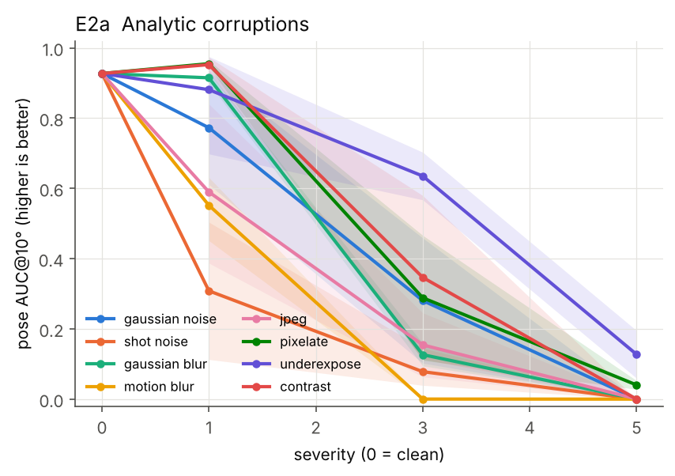
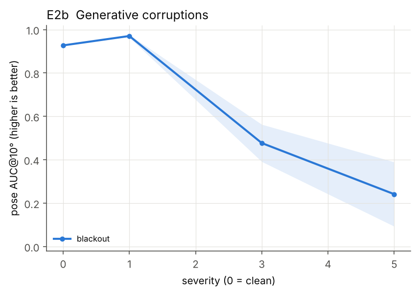
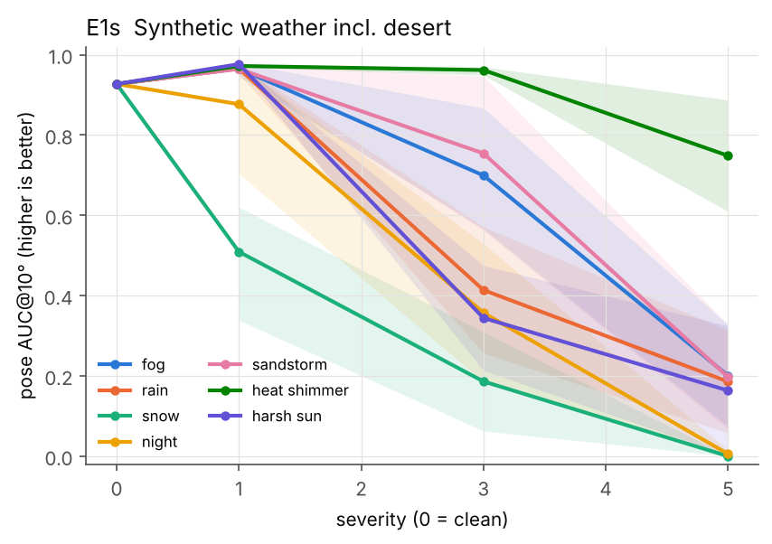
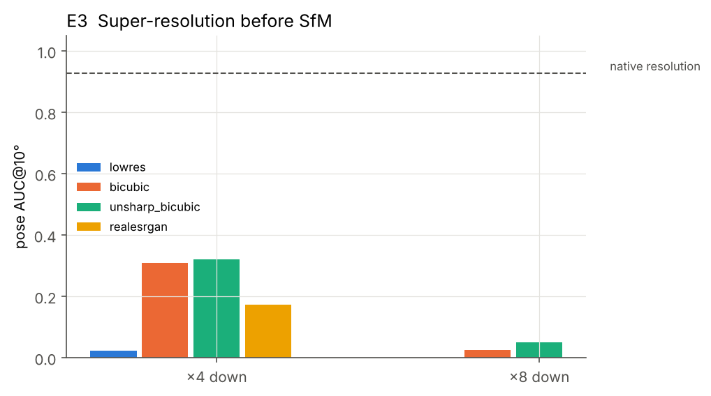
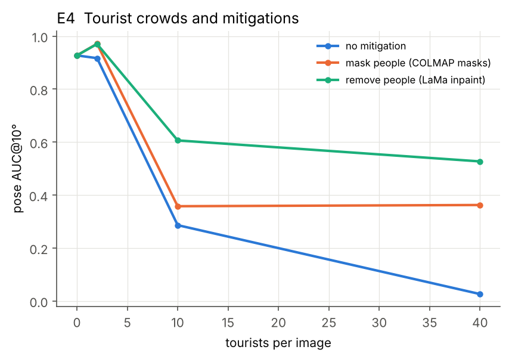
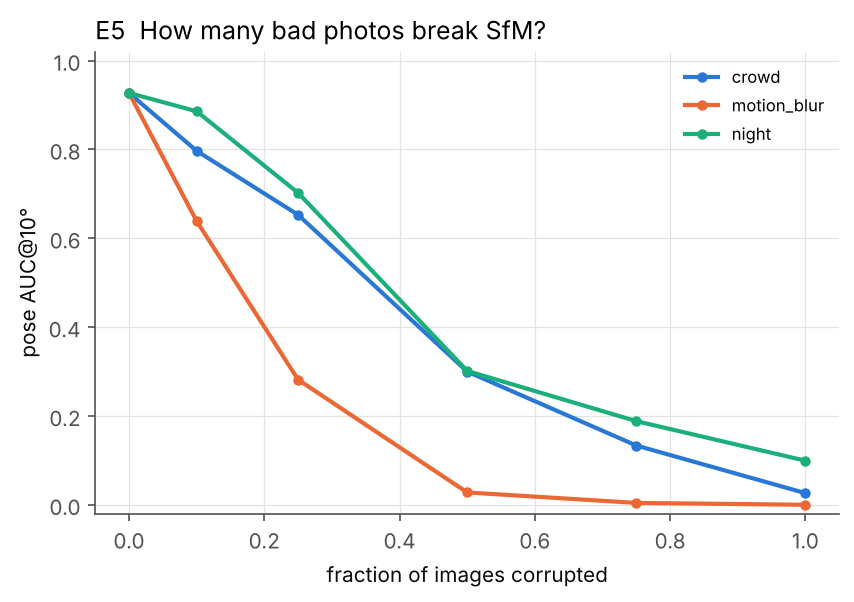
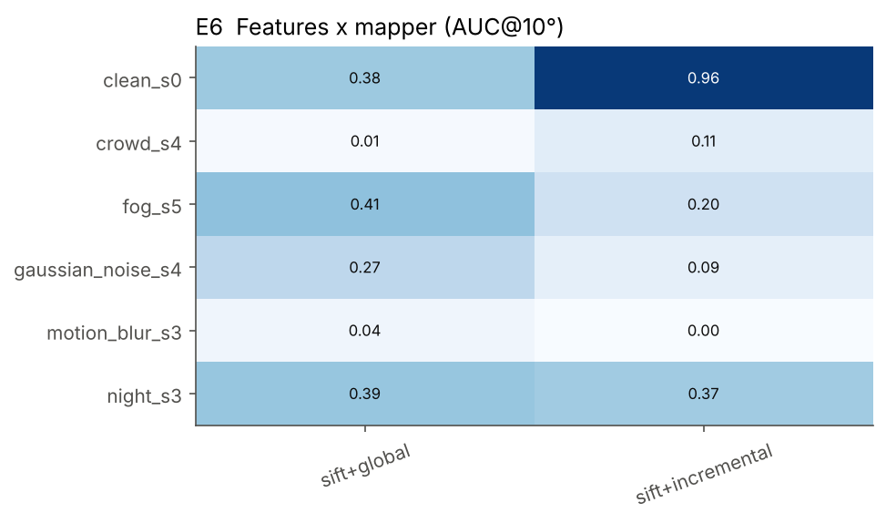
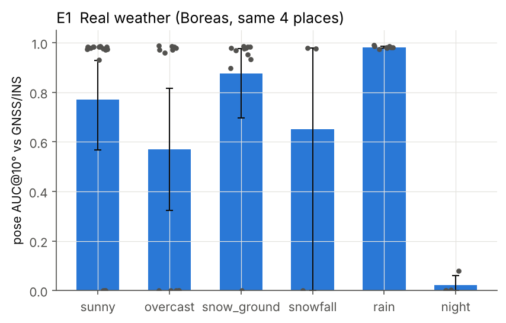
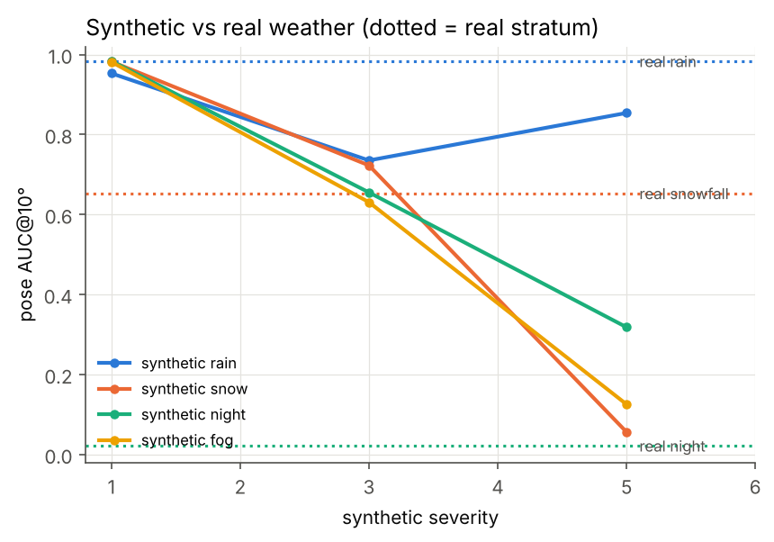
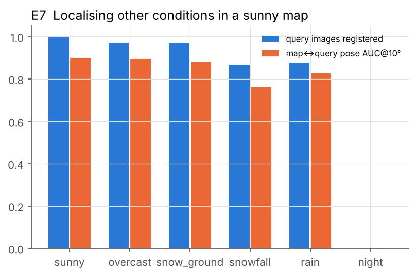

# Results summary (auto-generated by scripts/analyze.py)

Metric: pose AUC@10° over all input image pairs (unregistered = failure) and registration rate. Brackets: 95% bootstrap CI.

## Clean baseline

29 runs, AUC@10 = 0.927 (std 0.154), registration 1.000.

## E2a  Analytic corruptions

| perturb | severity | n | auc@10 | reg_frac |
|---|---|---|---|---|
| contrast | 1 | 4 | 0.952 [0.93, 0.97] | 1.000 [1.00, 1.00] |
| contrast | 3 | 4 | 0.347 [0.11, 0.58] | 0.570 [0.35, 0.79] |
| contrast | 5 | 4 | 0.000 [0.00, 0.00] | 0.000 [0.00, 0.00] |
| gaussian_blur | 1 | 4 | 0.915 [0.90, 0.93] | 1.000 [1.00, 1.00] |
| gaussian_blur | 3 | 4 | 0.127 [0.09, 0.16] | 0.372 [0.33, 0.42] |
| gaussian_blur | 5 | 4 | 0.000 [0.00, 0.00] | 0.000 [0.00, 0.00] |
| gaussian_noise | 1 | 4 | 0.773 [0.61, 0.93] | 1.000 [1.00, 1.00] |
| gaussian_noise | 3 | 4 | 0.281 [0.10, 0.46] | 0.544 [0.34, 0.75] |
| gaussian_noise | 5 | 4 | 0.000 [0.00, 0.00] | 0.045 [0.04, 0.05] |
| jpeg | 1 | 4 | 0.590 [0.39, 0.84] | 0.994 [0.98, 1.00] |
| jpeg | 3 | 4 | 0.154 [0.06, 0.25] | 0.448 [0.28, 0.62] |
| jpeg | 5 | 4 | 0.000 [0.00, 0.00] | 0.045 [0.04, 0.05] |
| motion_blur | 1 | 4 | 0.552 [0.45, 0.63] | 0.842 [0.71, 0.97] |
| motion_blur | 3 | 4 | 0.000 [0.00, 0.00] | 0.050 [0.04, 0.06] |
| motion_blur | 5 | 4 | 0.000 [0.00, 0.00] | 0.000 [0.00, 0.00] |
| pixelate | 1 | 4 | 0.955 [0.95, 0.96] | 1.000 [1.00, 1.00] |
| pixelate | 3 | 4 | 0.289 [0.11, 0.47] | 0.535 [0.35, 0.72] |
| pixelate | 5 | 4 | 0.040 [0.03, 0.05] | 0.215 [0.18, 0.25] |
| shot_noise | 1 | 4 | 0.308 [0.11, 0.50] | 0.590 [0.35, 0.83] |
| shot_noise | 3 | 4 | 0.078 [0.04, 0.14] | 0.285 [0.21, 0.39] |
| shot_noise | 5 | 4 | 0.000 [0.00, 0.00] | 0.020 [0.00, 0.04] |
| underexpose | 1 | 4 | 0.881 [0.70, 0.98] | 1.000 [1.00, 1.00] |
| underexpose | 3 | 4 | 0.635 [0.57, 0.70] | 0.900 [0.80, 1.00] |
| underexpose | 5 | 4 | 0.127 [0.06, 0.20] | 0.361 [0.26, 0.46] |

## E2b  Generative corruptions

| perturb | severity | n | auc@10 | reg_frac |
|---|---|---|---|---|
| blackout | 1 | 4 | 0.970 [0.96, 0.98] | 1.000 [1.00, 1.00] |
| blackout | 3 | 4 | 0.477 [0.39, 0.56] | 0.709 [0.64, 0.78] |
| blackout | 5 | 4 | 0.241 [0.09, 0.39] | 0.487 [0.32, 0.65] |

## E1s  Synthetic weather incl. desert

| perturb | severity | n | auc@10 | reg_frac |
|---|---|---|---|---|
| fog | 1 | 4 | 0.966 [0.95, 0.98] | 1.000 [1.00, 1.00] |
| fog | 3 | 4 | 0.699 [0.57, 0.87] | 0.890 [0.78, 1.00] |
| fog | 5 | 4 | 0.201 [0.07, 0.33] | 0.444 [0.29, 0.60] |
| harsh_sun | 1 | 4 | 0.977 [0.97, 0.98] | 1.000 [1.00, 1.00] |
| harsh_sun | 3 | 4 | 0.344 [0.21, 0.48] | 0.608 [0.47, 0.74] |
| harsh_sun | 5 | 4 | 0.163 [0.00, 0.32] | 0.365 [0.10, 0.63] |
| heat_shimmer | 1 | 4 | 0.972 [0.97, 0.98] | 1.000 [1.00, 1.00] |
| heat_shimmer | 3 | 4 | 0.962 [0.95, 0.97] | 1.000 [1.00, 1.00] |
| heat_shimmer | 5 | 4 | 0.748 [0.61, 0.89] | 0.939 [0.83, 1.00] |
| night | 1 | 4 | 0.877 [0.70, 0.98] | 1.000 [1.00, 1.00] |
| night | 3 | 4 | 0.357 [0.18, 0.53] | 0.605 [0.45, 0.76] |
| night | 5 | 4 | 0.005 [0.00, 0.02] | 0.076 [0.04, 0.14] |
| rain | 1 | 4 | 0.966 [0.95, 0.98] | 1.000 [1.00, 1.00] |
| rain | 3 | 4 | 0.414 [0.26, 0.57] | 0.764 [0.59, 0.94] |
| rain | 5 | 4 | 0.186 [0.06, 0.31] | 0.426 [0.26, 0.59] |
| sandstorm | 1 | 4 | 0.965 [0.95, 0.98] | 1.000 [1.00, 1.00] |
| sandstorm | 3 | 4 | 0.754 [0.56, 0.95] | 0.890 [0.78, 1.00] |
| sandstorm | 5 | 4 | 0.197 [0.07, 0.33] | 0.438 [0.28, 0.60] |
| snow | 1 | 4 | 0.509 [0.34, 0.62] | 0.740 [0.61, 0.83] |
| snow | 3 | 4 | 0.186 [0.06, 0.31] | 0.433 [0.28, 0.59] |
| snow | 5 | 4 | 0.000 [0.00, 0.00] | 0.010 [0.00, 0.03] |

## E3  Super-resolution

| severity | method | n | auc@10 | reg_frac |
|---|---|---|---|---|
| 4 | bicubic | 4 | 0.309 [0.11, 0.51] | 0.545 [0.35, 0.74] |
| 4 | lowres | 4 | 0.023 [0.00, 0.05] | 0.125 [0.00, 0.25] |
| 4 | realesrgan | 1 | 0.174 | 0.440 |
| 4 | unsharp_bicubic | 4 | 0.320 [0.11, 0.53] | 0.555 [0.35, 0.76] |
| 8 | bicubic | 4 | 0.026 [0.00, 0.05] | 0.145 [0.04, 0.25] |
| 8 | lowres | 4 | 0.000 [0.00, 0.00] | 0.037 [0.00, 0.07] |
| 8 | unsharp_bicubic | 4 | 0.051 [0.05, 0.05] | 0.245 [0.24, 0.25] |

## E4  Crowds

| mitigation | severity | n | auc@10 | reg_frac |
|---|---|---|---|---|
| lama_remove | 1 | 1 | 0.970 | 1.000 |
| lama_remove | 3 | 1 | 0.606 | 1.000 |
| lama_remove | 5 | 1 | 0.527 | 0.960 |
| mask | 1 | 4 | 0.971 [0.97, 0.97] | 1.000 [1.00, 1.00] |
| mask | 3 | 4 | 0.358 [0.21, 0.51] | 0.739 [0.57, 0.92] |
| mask | 5 | 3 | 0.362 [0.16, 0.47] | 0.688 [0.62, 0.72] |
| none | 1 | 4 | 0.917 [0.84, 0.97] | 1.000 [1.00, 1.00] |
| none | 3 | 4 | 0.286 [0.11, 0.46] | 0.963 [0.92, 1.00] |
| none | 5 | 3 | 0.026 [0.00, 0.07] | 0.775 [0.33, 1.00] |

## E5  Contamination

| perturb | frac | n | auc@10 | reg_frac |
|---|---|---|---|---|
| clean | 1.000 | 4 | 0.971 [0.96, 0.98] | 1.000 [1.00, 1.00] |
| crowd | 0.100 | 4 | 0.797 [0.63, 0.96] | 0.938 [0.81, 1.00] |
| crowd | 0.250 | 4 | 0.653 [0.55, 0.82] | 1.000 [1.00, 1.00] |
| crowd | 0.500 | 4 | 0.300 [0.16, 0.44] | 0.870 [0.73, 0.99] |
| crowd | 0.750 | 4 | 0.133 [0.06, 0.21] | 0.958 [0.90, 0.99] |
| crowd | 1.000 | 4 | 0.026 [0.01, 0.04] | 0.994 [0.98, 1.00] |
| motion_blur | 0.100 | 4 | 0.639 [0.52, 0.75] | 0.856 [0.77, 0.90] |
| motion_blur | 0.250 | 4 | 0.282 [0.13, 0.45] | 0.522 [0.38, 0.67] |
| motion_blur | 0.500 | 4 | 0.028 [0.00, 0.07] | 0.150 [0.09, 0.27] |
| motion_blur | 0.750 | 4 | 0.004 [0.00, 0.01] | 0.079 [0.07, 0.09] |
| motion_blur | 1.000 | 4 | 0.000 [0.00, 0.00] | 0.013 [0.00, 0.04] |
| night | 0.100 | 4 | 0.886 [0.76, 0.96] | 1.000 [1.00, 1.00] |
| night | 0.250 | 4 | 0.702 [0.58, 0.87] | 0.889 [0.78, 1.00] |
| night | 0.500 | 4 | 0.301 [0.16, 0.48] | 0.552 [0.41, 0.71] |
| night | 0.750 | 4 | 0.188 [0.11, 0.29] | 0.440 [0.35, 0.55] |
| night | 1.000 | 4 | 0.099 [0.06, 0.16] | 0.321 [0.25, 0.40] |

## E6  Methods

| condition         |   sift+global |   sift+incremental |
|:------------------|--------------:|-------------------:|
| clean_s0          |         0.4   |              0.962 |
| crowd_s4          |         0.006 |              0.099 |
| fog_s5            |         0.313 |              0.19  |
| gaussian_noise_s4 |         0.215 |              0.108 |
| motion_blur_s3    |         0.058 |              0     |
| night_s3          |         0.374 |              0.369 |

## E1  Real weather (Boreas)

| stratum | n | auc@10 | reg_frac |
|---|---|---|---|
| sunny | 57 | 0.736 [0.62, 0.84] | 0.756 [0.63, 0.86] |
| overcast | 36 | 0.539 [0.38, 0.70] | 0.557 [0.39, 0.72] |
| snow_ground | 33 | 0.880 [0.77, 0.96] | 0.909 [0.79, 1.00] |
| snowfall | 9 | 0.652 [0.33, 0.98] | 0.667 [0.33, 1.00] |
| rain | 24 | 0.866 [0.75, 0.98] | 0.960 [0.88, 1.00] |
| night | 12 | 0.023 [0.01, 0.04] | 0.511 [0.34, 0.69] |

Per sequence:

| stratum | seq | n | auc@10 | reg_frac |
|---|---|---|---|---|
| night | boreas-2021-09-14-20-00 | 12 | 0.023 [0.01, 0.04] | 0.511 [0.34, 0.69] |
| overcast | boreas-2020-11-26-13-58 | 12 | 0.798 [0.56, 0.96] | 0.838 [0.59, 1.00] |
| overcast | boreas-2021-01-19-15-08 | 12 | 0.655 [0.41, 0.90] | 0.667 [0.42, 0.92] |
| overcast | boreas-2021-11-16-14-10 | 12 | 0.165 [0.00, 0.41] | 0.167 [0.00, 0.42] |
| rain | boreas-2021-04-29-15-55 | 12 | 0.906 [0.75, 0.99] | 1.000 [1.00, 1.00] |
| rain | boreas-2021-07-20-17-33 | 12 | 0.825 [0.61, 0.98] | 0.921 [0.76, 1.00] |
| snow_ground | boreas-2020-12-01-13-26 | 12 | 0.954 [0.93, 0.97] | 1.000 [1.00, 1.00] |
| snow_ground | boreas-2021-01-15-12-17 | 9 | 0.975 [0.97, 0.99] | 1.000 [1.00, 1.00] |
| snow_ground | boreas-2021-02-02-14-07 | 12 | 0.733 [0.49, 0.97] | 0.750 [0.50, 1.00] |
| snowfall | boreas-2021-01-26-11-22 | 9 | 0.652 [0.33, 0.98] | 0.667 [0.33, 1.00] |
| sunny | boreas-2020-12-18-13-44 | 9 | 0.983 [0.98, 0.98] | 1.000 [1.00, 1.00] |
| sunny | boreas-2021-04-08-12-44 | 12 | 0.818 [0.57, 0.98] | 0.838 [0.60, 1.00] |
| sunny | boreas-2021-06-03-16-00 | 12 | 0.567 [0.32, 0.81] | 0.588 [0.33, 0.84] |
| sunny | boreas-2021-08-05-13-34 | 12 | 0.409 [0.16, 0.73] | 0.417 [0.17, 0.75] |
| sunny | boreas-2021-11-23-14-27 | 12 | 0.966 [0.95, 0.98] | 1.000 [1.00, 1.00] |

## E1-gap  Synthetic weather applied to the sunny Boreas runs

| perturb | severity | n | auc@10 | reg_frac |
|---|---|---|---|---|
| fog | 1 | 19 | 0.683 [0.48, 0.88] | 0.737 [0.53, 0.89] |
| fog | 3 | 19 | 0.774 [0.62, 0.90] | 0.947 [0.84, 1.00] |
| fog | 5 | 19 | 0.172 [0.08, 0.28] | 0.455 [0.29, 0.64] |
| night | 1 | 19 | 0.528 [0.31, 0.74] | 0.582 [0.37, 0.79] |
| night | 3 | 19 | 0.574 [0.36, 0.77] | 0.639 [0.43, 0.84] |
| night | 5 | 19 | 0.326 [0.15, 0.52] | 0.636 [0.42, 0.84] |
| rain | 1 | 19 | 0.663 [0.45, 0.86] | 0.687 [0.48, 0.89] |
| rain | 3 | 19 | 0.524 [0.31, 0.73] | 0.591 [0.38, 0.80] |
| rain | 5 | 19 | 0.566 [0.37, 0.75] | 0.741 [0.54, 0.94] |
| snow | 1 | 19 | 0.717 [0.51, 0.88] | 0.739 [0.53, 0.90] |
| snow | 3 | 19 | 0.430 [0.24, 0.62] | 0.668 [0.46, 0.85] |
| snow | 5 | 19 | 0.043 [0.01, 0.09] | 0.366 [0.19, 0.57] |

## E7  Cross-season localisation

| stratum | n | query_reg | cross_auc@10 |
|---|---|---|---|
| sunny | 45 | 1.000 [1.00, 1.00] | 0.899 [0.85, 0.93] |
| overcast | 36 | 0.972 [0.92, 1.00] | 0.895 [0.83, 0.94] |
| snow_ground | 33 | 0.971 [0.91, 1.00] | 0.878 [0.80, 0.94] |
| snowfall | 9 | 0.867 [0.73, 1.00] | 0.762 [0.61, 0.89] |
| rain | 24 | 0.875 [0.75, 1.00] | 0.827 [0.70, 0.94] |
| night | 12 | 0.000 [0.00, 0.00] | 0.000 [0.00, 0.00] |
